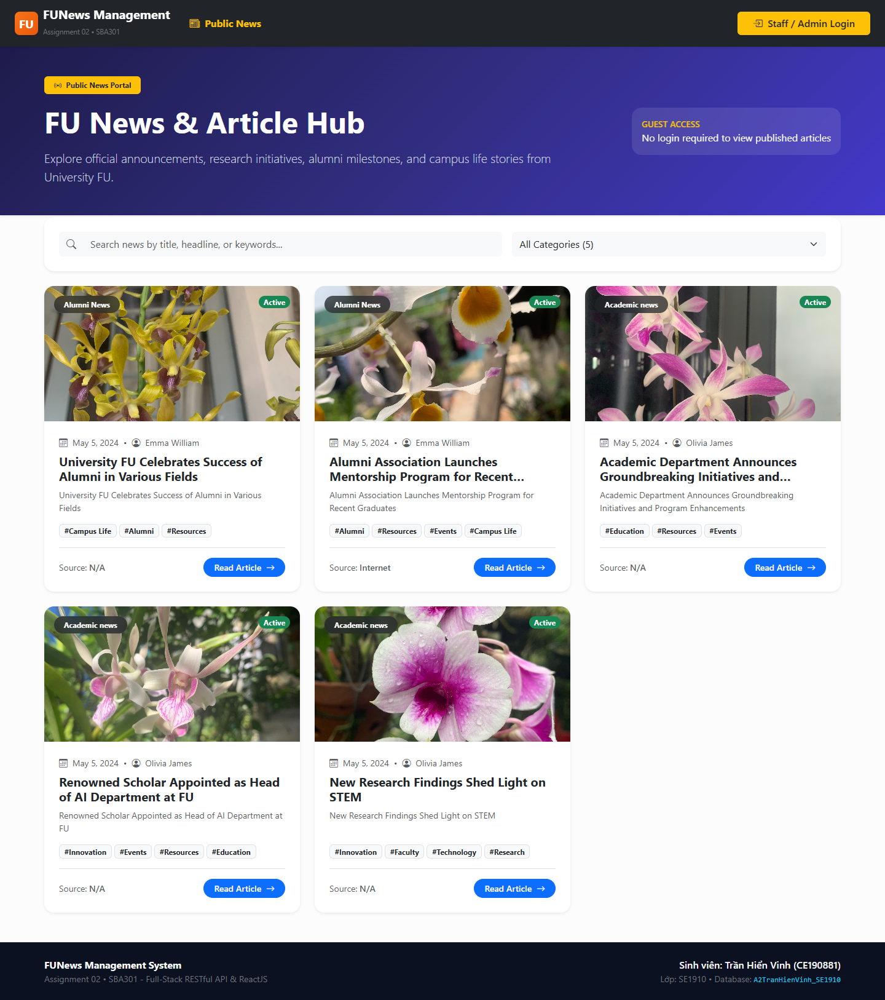
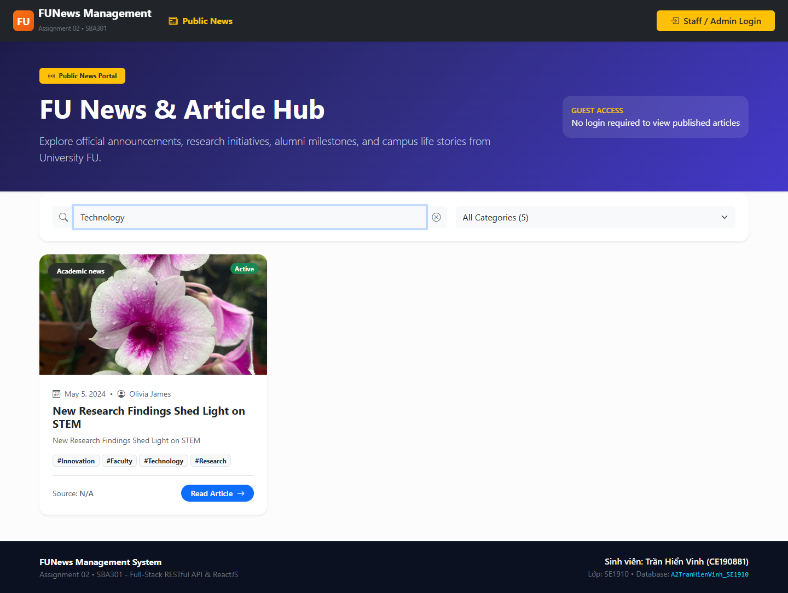
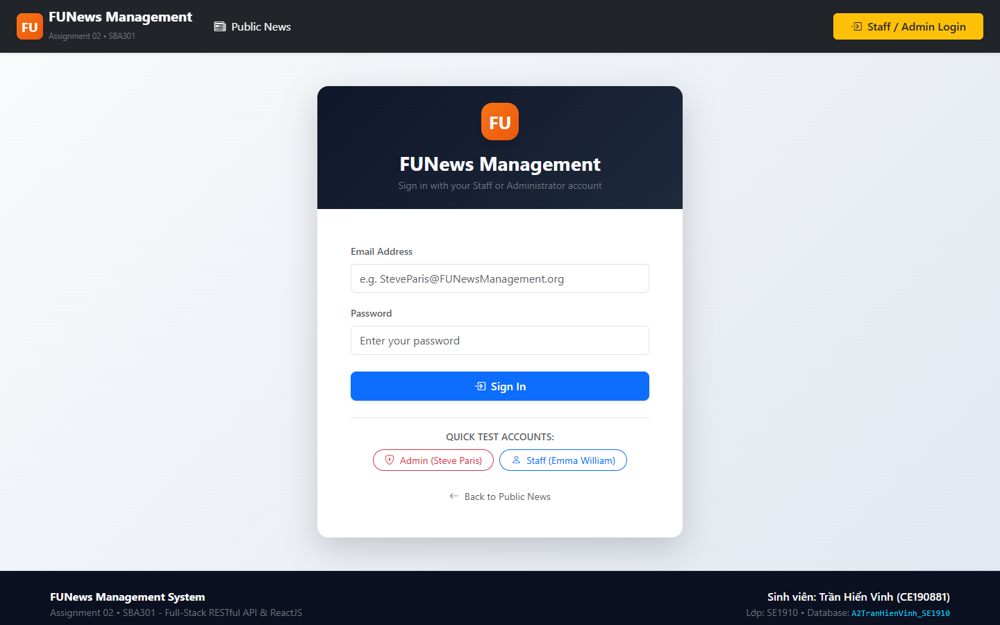
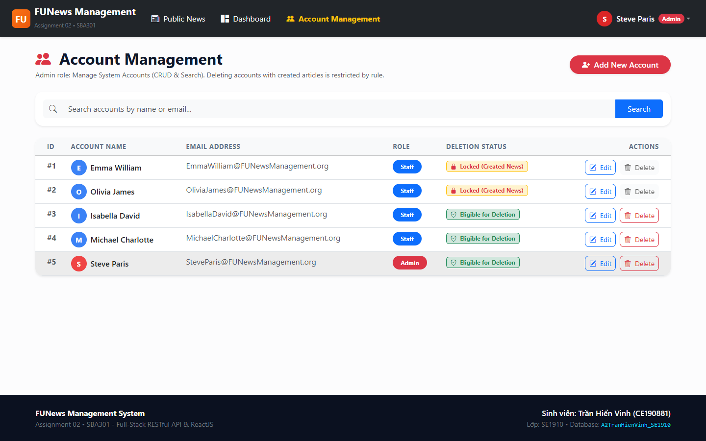
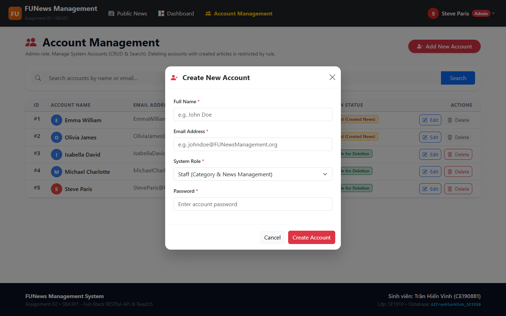
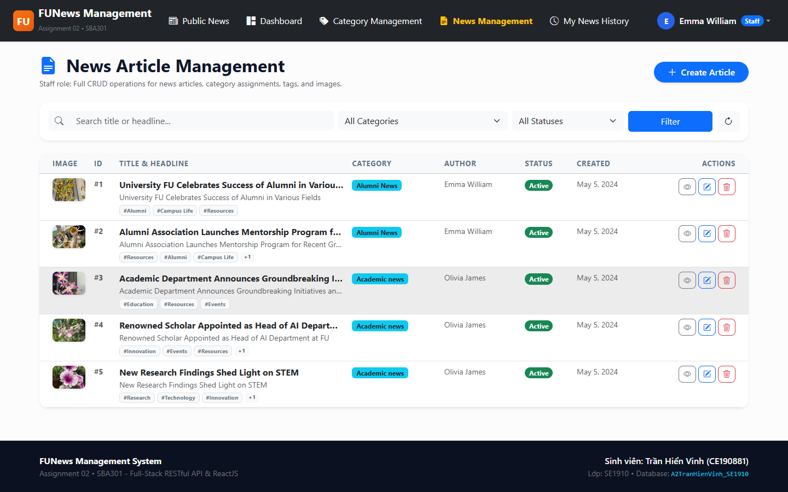
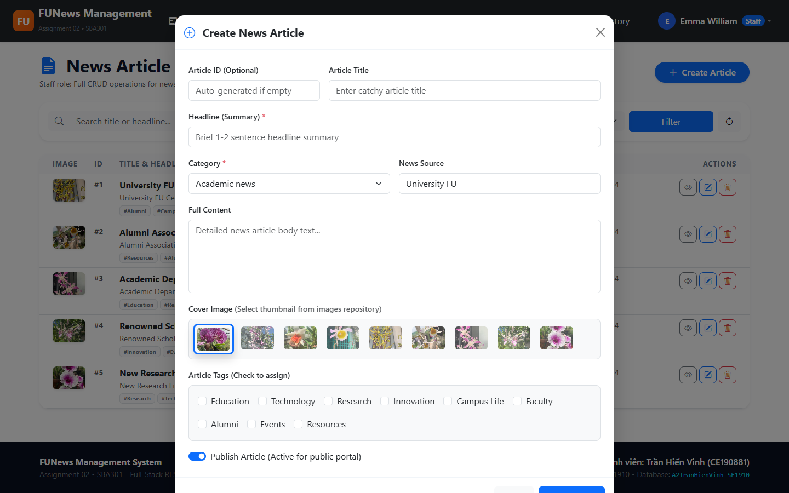
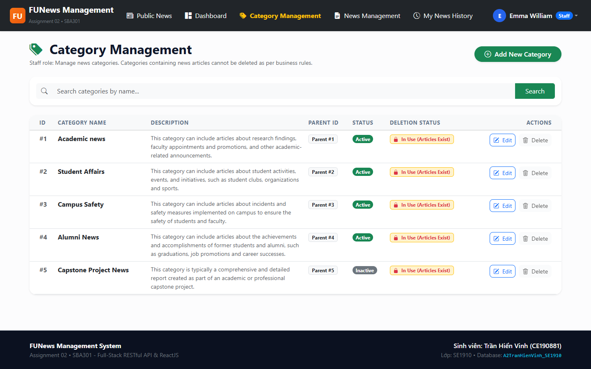
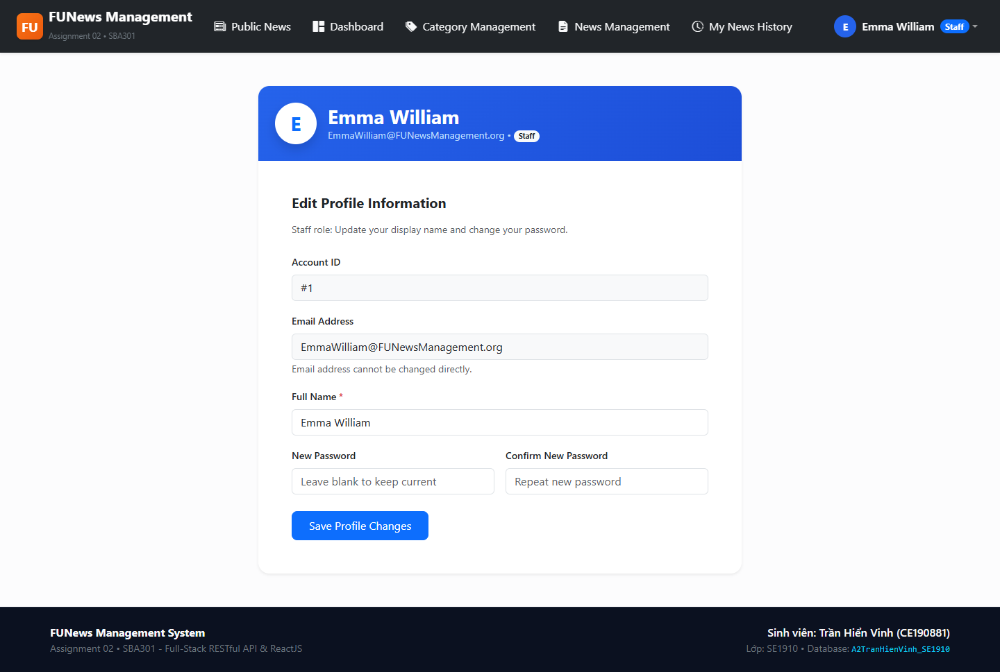
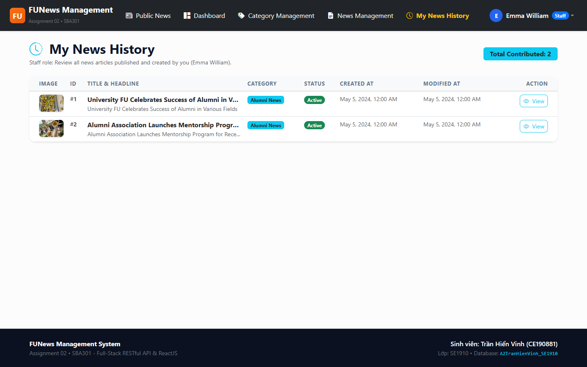

# TRƯỜNG ĐẠI HỌC FPT CẦN THƠ
## BỘ MÔN KỸ THUẬT PHẦN MỀM (SOFTWARE ENGINEERING)
---
# BÁO CÁO TỔNG HỢP GIAO DIỆN & TẤT CẢ CHỨC NĂNG HỆ THỐNG
## ASSIGNMENT 02 - FU NEWS MANAGEMENT SYSTEM
**Môn học:** SBA301 - Integrate Single Page Application with Spring Boot  
**Học kỳ:** Fall 2024 / Spring 2025  
**Sinh viên thực hiện:** TRẦN HIỂN VINH  
**MSSV:** CE190881  
**Lớp:** SE1910  
**Tên Cơ sở dữ liệu:** `A2TranHienVinh_SE1910`  
**Nền tảng công nghệ:** Spring Boot 3 RESTful API (3-Layer Architecture) + ReactJS (Vite) + Microsoft SQL Server  

---

## I. TỔNG QUAN ĐỀ BÀI & DANH MỤC YÊU CẦU NGHIỆP VỤ (REQUIREMENTS SPECIFICATION)

### 1.1. Bối cảnh & Mục tiêu đề tài
Hệ thống Quản lý Tin tức (FUNewsManagementSystem) được xây dựng nhằm hỗ trợ các trường đại học và cơ sở giáo dục tổ chức, quản lý và xuất bản tin tức nội bộ một cách hiệu quả, chuyên nghiệp.

Dự án Assignment 02 yêu cầu sinh viên hiện thực hóa toàn bộ các dịch vụ RESTful API đa tầng bằng Spring Boot 3 kết hợp giao diện Single Page Application (SPA) trên nền ReactJS (Vite) và hệ quản trị cơ sở dữ liệu Microsoft SQL Server.

### 1.2. Quy định kỹ thuật bắt buộc từ Đề bài (PDF Specification)
- **Tên Database bắt buộc:** `A2StudentName_ClassCode` -> `A2TranHienVinh_SE1910`.
- **Tên Project Backend:** `A2TranHienVinh_SE1910` (Spring Boot 3, 3-Layer Architecture).
- **Tên Project Frontend:** `A2TranHienVinh_SE1910` (ReactJS Vite, Axios, Bootstrap).
- **Giao diện CRUD bắt buộc:** Các hành động Tạo mới (Create) và Cập nhật (Update) **PHẢI** thực hiện thông qua Popup Dialog (Modal). Hành động Xóa (Delete) **LUÔN LUÔN PHẢI** đi kèm hộp thoại xác nhận (Confirmation Dialog).
- **Tìm kiếm (Search):** Cung cấp tính năng tìm kiếm tức thời cho tất cả các bảng quản trị (Tin tức, Danh mục, Tài khoản).
- **Validation:** Kiểm tra và chuẩn hóa kiểu dữ liệu cho toàn bộ các trường nhập liệu.

### 1.3. Bảng đối chiếu Ma trận Yêu cầu Đề bài (Requirements Traceability Matrix)

| STT | Vai trò (Role) | Yêu cầu Nghiệp vụ theo Đề bài | Ràng buộc Nghiệp vụ (Business Rules) | Trạng thái |
| :---: | :--- | :--- | :--- | :---: |
| **1** | Public Guest | Xem danh sách bài viết tin tức công khai | Chỉ xem các bài viết có trạng thái Active (`NewsStatus = 1`), không cần đăng nhập | **ĐẠT 100%** |
| **2** | Public Guest | Tìm kiếm và lọc tin tức công khai | Tìm kiếm theo từ khóa trong tiêu đề/nội dung hoặc lọc theo chuyên mục (Category) | **ĐẠT 100%** |
| **3** | Member (Staff/Admin) | Xác thực người dùng (Authentication) | Đăng nhập bằng Email và Password, phân quyền theo `AccountRole` (1: Admin, 2: Staff) | **ĐẠT 100%** |
| **4** | Admin (Role 1) | Quản lý Tài khoản (CRUD + Search) | Tạo mới, xem, sửa, tìm kiếm tài khoản người dùng qua Popup Dialog | **ĐẠT 100%** |
| **5** | Admin (Role 1) | Xóa tài khoản có ràng buộc | **CHẶN XÓA** nếu tài khoản đã từng tạo bài viết trong bảng `NewsArticle` | **ĐẠT 100%** |
| **6** | Staff (Role 2) | Quản lý Chuyên mục (Category CRUD) | Thêm, sửa, xem danh mục cha/con bằng Modal, tìm kiếm danh mục | **ĐẠT 100%** |
| **7** | Staff (Role 2) | Xóa chuyên mục có ràng buộc | **CHẶN XÓA** nếu Category đang chứa bài viết hoặc có danh mục con trực thuộc | **ĐẠT 100%** |
| **8** | Staff (Role 2) | Quản lý Bài viết Tin tức (CRUD + Search) | Thêm/sửa qua Modal, gắn thẻ Tags cho bài viết, chọn chuyên mục, bật/tắt trạng thái | **ĐẠT 100%** |
| **9** | Staff (Role 2) | Quản lý Hồ sơ cá nhân (Profile) | Xem và cập nhật thông tin cá nhân và mật khẩu của chính tài khoản nhân viên | **ĐẠT 100%** |
| **10** | Staff (Role 2) | Xem lịch sử bài viết cá nhân (History) | Màn hình riêng hiển thị các bài viết do chính nhân viên đăng nhập khởi tạo | **ĐẠT 100%** |

---

## II. KIẾN TRÚC HỆ THỐNG & GIẢI PHÁP KỸ THUẬT (3-LAYER ARCHITECTURE)

Dự án được xây dựng theo mô hình phân tầng chuẩn doanh nghiệp (3-Layer Architecture with Repository Pattern):
1. **Tầng Thực thể (Entity Layer):** Ánh xạ các bảng CSDL sang Java Classes bằng Jakarta Persistence (JPA). Bao gồm 4 thực thể: `SystemAccount`, `Category`, `NewsArticle`, `Tag`.
2. **Tầng Truy cập Dữ liệu (Repository Layer):** Kế thừa `JpaRepository`, cung cấp các truy vấn tự sinh (Derived Queries) như `existsByCreatedBy_AccountID`, `existsByCategory_CategoryID`, `existsByParentCategory_CategoryID`.
3. **Tầng Nghiệp vụ (Service Layer):** Nơi hiện thực hóa toàn bộ Business Logic và kiểm soát tính toàn vẹn dữ liệu. Quản lý giao dịch (`@Transactional`), kiểm tra các quy tắc chặn xóa bài viết/danh mục trước khi thao tác CSDL.
4. **Tầng Điều khiển (Controller Layer):** Tiếp nhận HTTP Request (`GET`, `POST`, `PUT`, `DELETE`), Validate đầu vào (`@Valid`), trả về `ResponseEntity` kèm HTTP Status Code chuẩn RESTful (`200 OK`, `201 Created`, `400 Bad Request`, `404 Not Found`).
5. **Tầng Giao diện Người dùng (ReactJS Client):** Ứng dụng SPA trên nền Vite, React Router DOM v6, Axios Client và giao diện React-Bootstrap & Bootstrap Icons.

---

## III. QUY TRÌNH CHỨC NĂNG & HÌNH ẢNH DEMO CHI TIẾT (TẤT CẢ MÀN HÌNH)

### 1. Màn hình Trang chủ Tin tức Công khai (Public News Home)
Người dùng vãng lai (khách không cần đăng nhập) có thể truy cập ngay trang chủ để theo dõi toàn bộ các bài viết tin tức đang hoạt động (`NewsStatus = 1`). Các bài viết được hiển thị trực quan dưới dạng thẻ Card với tiêu đề, trích dẫn headline, ngày đăng, chuyên mục và tác giả.


*Hình 1: Giao diện Trang chủ Tin tức Công khai dành cho Public Guest*

### 2. Chức năng Tìm kiếm & Lọc Tin tức Tức thời (Search & Category Filter)
Khách có thể nhập từ khóa vào ô tìm kiếm để lọc bài viết theo tiêu đề/nội dung hoặc nhấp chọn các nút danh mục (Category) trên thanh điều hướng để xem các bài viết chuyên biệt.


*Hình 2: Kết quả tìm kiếm và lọc bài viết tin tức theo chuyên mục và từ khóa*

### 3. Màn hình Đăng nhập Hệ thống (Authentication Login)
Màn hình tiếp nhận Email và Password của thành viên. Hệ thống tự động kiểm tra tài khoản, mã hóa xác thực và phân luồng điều hướng: Admin (Role = 1) vào trang Quản lý Tài khoản, Staff (Role = 2) vào trang Quản lý Tin tức.


*Hình 3: Giao diện Đăng nhập Hệ thống FUNewsManagement*

### 4. Màn hình Quản lý Tài khoản Người dùng (Admin Account Management)
Chỉ Quản trị viên (Admin) mới có quyền truy cập. Bảng hiển thị danh sách toàn bộ tài khoản với Account ID, Tên người dùng, Email, Vai trò (Admin/Staff badge) và các nút thao tác Thêm, Sửa, Xóa, Tìm kiếm.


*Hình 4: Bảng Quản trị Danh sách Tài khoản dành cho Administrator*

### 5. Hộp thoại Thêm mới / Cập nhật Tài khoản (Create/Edit Account Modal)
Đáp ứng 100% yêu cầu đề bài: Thao tác Tạo mới và Sửa tài khoản **BẮT BUỘC** phải thực hiện qua Popup Dialog (Modal) với đầy đủ validate: kiểm tra định dạng email, độ dài mật khẩu và bắt buộc chọn vai trò.


*Hình 5: Hộp thoại Modal Tạo mới / Cập nhật Tài khoản người dùng*

### 6. Màn hình Quản trị Bài viết Tin tức (Staff News Article Management)
Nhân viên (Staff) quản lý toàn bộ danh sách bài viết trong tòa soạn: hiển thị Tiêu đề, Chuyên mục, Tác giả, Ngày tạo/chỉnh sửa, Trạng thái (Active/Inactive) và danh sách Thẻ Tags đi kèm bài viết.


*Hình 6: Màn hình Quản lý Bài viết Tin tức dành cho Nhân viên Staff*

### 7. Hộp thoại Soạn thảo / Thêm mới Tin tức (Create News Article Modal)
Popup Dialog soạn thảo bài viết gồm: Tiêu đề bài viết, Headline, Nội dung chi tiết, Nguồn tin (News Source), Chọn danh mục chuyên mục (Category dropdown), Bật/tắt trạng thái Active và Chọn nhiều thẻ Tags cùng lúc.


*Hình 7: Hộp thoại Modal Soạn thảo và Tạo mới Bài viết Tin tức*

### 8. Màn hình Quản lý Chuyên mục Tin tức (Category Management)
Staff quản lý cây danh mục tin tức (Category Name, Description, Parent Category, Trạng thái). Hỗ trợ thêm/sửa qua Modal và tìm kiếm danh mục. Nút Xóa có hộp thoại xác nhận và kiểm tra ràng buộc không cho xóa nếu danh mục đang chứa bài viết hoặc có danh mục con.


*Hình 8: Màn hình Quản trị Danh mục Chuyên mục Tin tức (Category)*

### 9. Màn hình Quản lý Hồ sơ Cá nhân (Staff Profile Management)
Nhân viên xem thông tin tài khoản của chính mình và có thể tự cập nhật Tên hiển thị, Mật khẩu mới để nâng cao tính bảo mật cá nhân.


*Hình 9: Màn hình Cập nhật Hồ sơ cá nhân của Nhân viên Staff*

### 10. Màn hình Lịch sử Bài viết do Nhân viên khởi tạo (Staff News History)
Màn hình chuyên biệt chỉ hiển thị danh sách các bài viết do chính nhân viên đang đăng nhập biên soạn (`CreatedByID = loggedUserId`). Giúp nhân viên dễ dàng rà soát và theo dõi tiến độ xuất bản của mình.


*Hình 10: Màn hình Lịch sử Bài viết cá nhân của Nhân viên Staff*

---

## IV. GIẢI THÍCH MÃ NGUỒN CHI TIẾT THEO TỪNG TẦNG

### 4.1. Tầng Repository: Kiểm tra Điều kiện Ràng buộc Nghiệp vụ
```java
// NewsArticleRepository.java
public interface NewsArticleRepository extends JpaRepository<NewsArticle, String> {
    // Kiểm tra xem tài khoản có bài viết nào không (dùng để chặn xóa Account)
    boolean existsByCreatedBy_AccountID(Short accountId);

    // Kiểm tra xem danh mục có bài viết nào không (dùng để chặn xóa Category)
    boolean existsByCategory_CategoryID(Short categoryId);
}

// CategoryRepository.java
public interface CategoryRepository extends JpaRepository<Category, Short> {
    // Kiểm tra xem danh mục có chuyên mục con không (dùng để chặn xóa Category cha)
    boolean existsByParentCategory_CategoryID(Short parentId);
}
```

### 4.2. Tầng Service: Ràng buộc Chặn xóa Tài khoản (`SystemAccountServiceImpl.java`)
Theo đúng yêu cầu đề bài: *"The delete action will delete an account in the case this account is not belong to any news articles (created), if the account is already created any news article, cannot delete"*:
```java
@Override
@Transactional
public void deleteAccount(Short accountId) {
    SystemAccount account = systemAccountRepository.findById(accountId)
            .orElseThrow(() -> new ResourceNotFoundException("Account not found with ID: " + accountId));
            
    // Business Rule Bắt buộc từ Đề bài: Chặn xóa tài khoản nếu đã từng tạo bài viết
    boolean hasNews = newsArticleRepository.existsByCreatedBy_AccountID(accountId);
    if (hasNews) {
        throw new BadRequestException("Không thể xóa tài khoản này vì tài khoản đã tạo bài viết tin tức!");
    }
    
    systemAccountRepository.delete(account);
}
```

### 4.3. Tầng Service: Ràng buộc Chặn xóa Chuyên mục (`CategoryServiceImpl.java`)
Theo đúng yêu cầu đề bài: *"The delete action will delete an item in the case this item is not belong to any news articles. If the item is already stored in a news article cannot delete"*:
```java
@Override
@Transactional
public void deleteCategory(Short categoryId) {
    Category category = categoryRepository.findById(categoryId)
            .orElseThrow(() -> new ResourceNotFoundException("Category not found with ID: " + categoryId));

    // Ràng buộc 1: Chặn xóa nếu đang có chuyên mục con trực thuộc
    if (categoryRepository.existsByParentCategory_CategoryID(categoryId)) {
        throw new BadRequestException("Không thể xóa chuyên mục này vì đang có chuyên mục con trực thuộc!");
    }
    // Ràng buộc 2: Chặn xóa nếu đang chứa bài viết tin tức
    if (newsArticleRepository.existsByCategory_CategoryID(categoryId)) {
        throw new BadRequestException("Không thể xóa chuyên mục này vì đang có bài viết thuộc chuyên mục!");
    }

    categoryRepository.delete(category);
}
```

---

## V. BỘ DỮ LIỆU KIỂM THỬ & HƯỚNG DẪN VẬN HÀNH

### 5.1. Bảng Tài khoản Kiểm thử Hệ thống (Test Credentials)

| Vai trò (Role) | Địa chỉ Email | Mật khẩu | Họ tên hiển thị | Quyền hạn chính |
| :--- | :--- | :---: | :--- | :--- |
| **Administrator (1)** | `SteveParis@FUNewsManagement.org` | `@1` | Steve Paris | Quản lý toàn bộ tài khoản (CRUD, Search), chặn xóa nếu có bài |
| **Staff (2)** | `EmmaWilliam@FUNewsManagement.org` | `@1` | Emma William | Quản lý bài viết (CRUD, Tags), chuyên mục (CRUD), Profile, Lịch sử |
| **Staff (2)** | `OliviaJames@FUNewsManagement.org` | `@1` | Olivia James | Quản lý bài viết, chuyên mục, lịch sử bài viết cá nhân |
| **Public Guest** | *Không yêu cầu* | *Không yêu cầu* | Khách vãng lai | Xem danh sách tin tức Active, tìm kiếm và lọc chuyên mục |

### 5.2. Hướng dẫn Khởi chạy và Vận hành Hệ thống
1. **Cơ sở dữ liệu:** Mở SSMS hoặc sqlcmd, thực thi script database tại `A2TranHienVinh_SE1910/database/FUNewsManagementSBA301.sql` để tạo CSDL `A2TranHienVinh_SE1910`.
2. **Khởi chạy Backend Spring Boot (Port 8080):**
   ```bash
   cd A2TranHienVinh_SE1910/backend
   mvn clean spring-boot:run
   ```
3. **Khởi chạy Frontend ReactJS Vite (Port 5173):**
   ```bash
   cd A2TranHienVinh_SE1910/frontend
   npm install
   npm run dev
   ```
4. **Kiểm thử API qua Postman:** Import file `A2TranHienVinh_SE1910/A2TranHienVinh_SE1910.postman_collection.json` vào Postman để kiểm thử toàn diện các endpoint RESTful.
