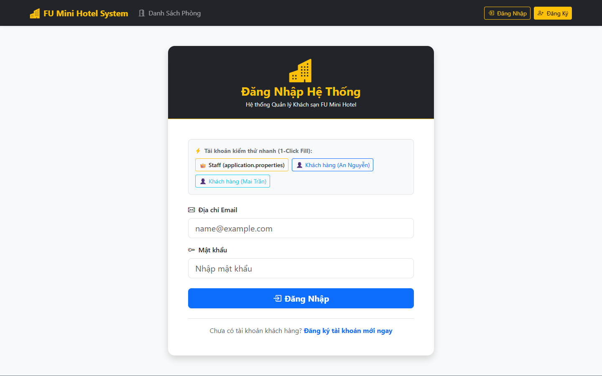
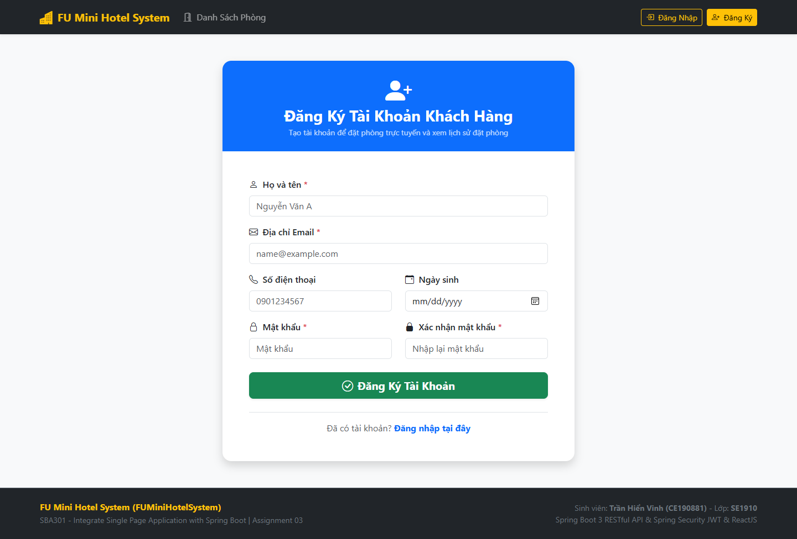
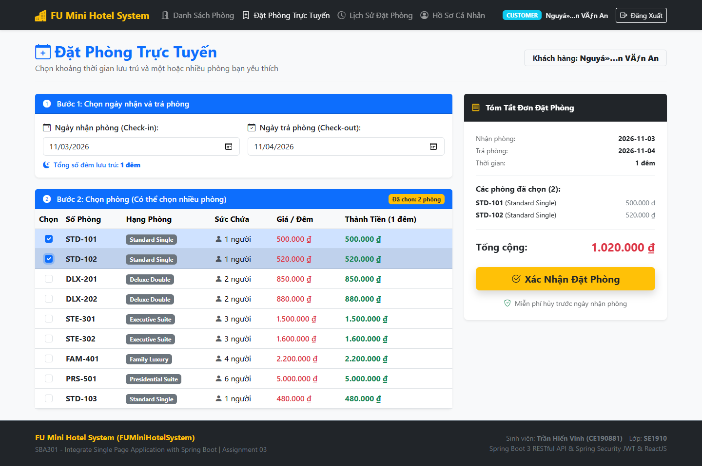
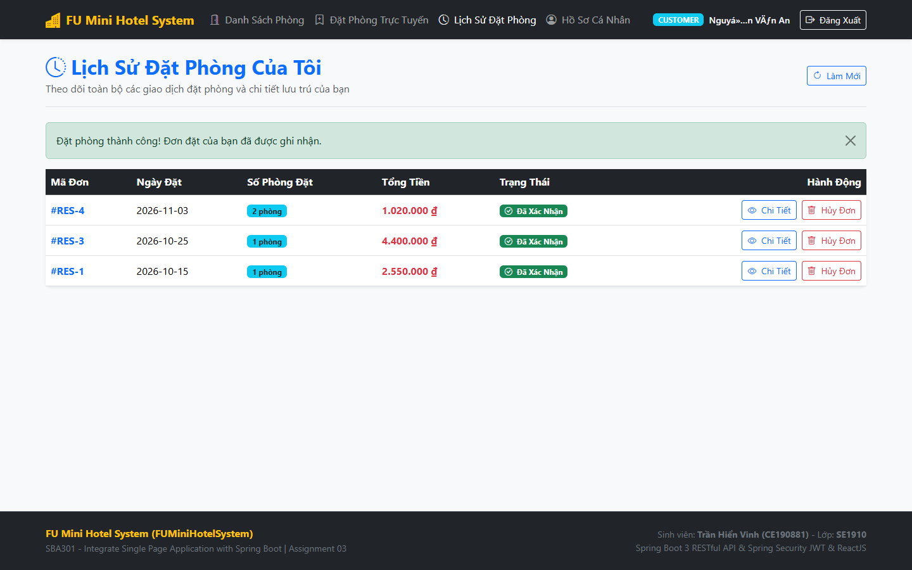
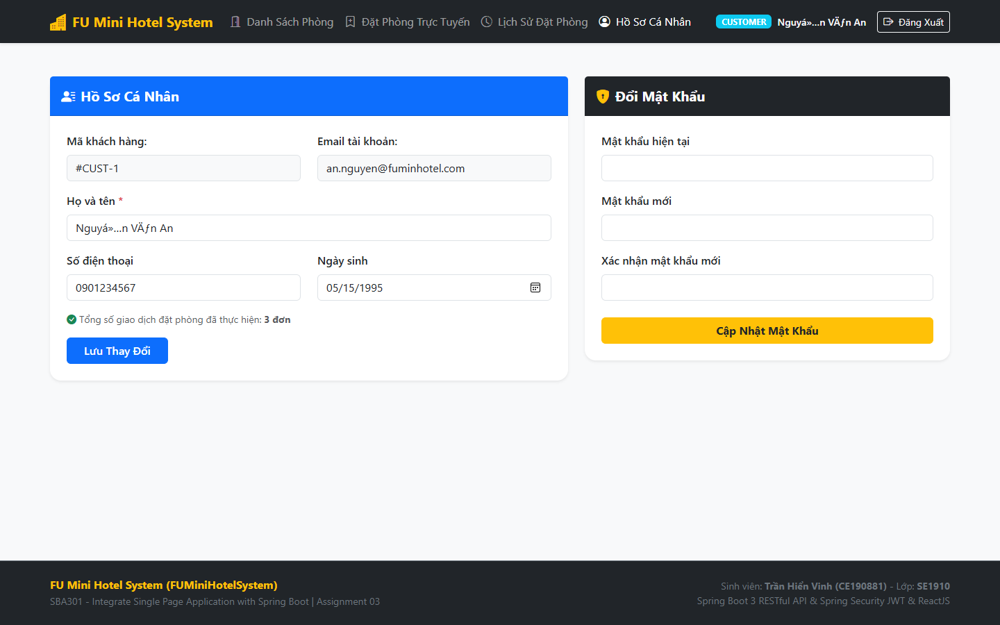
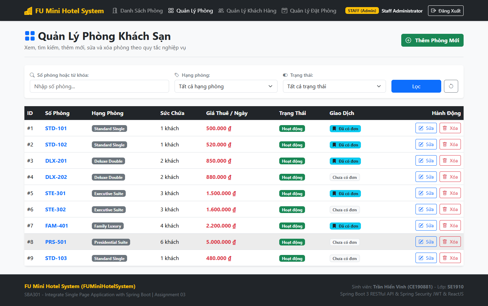
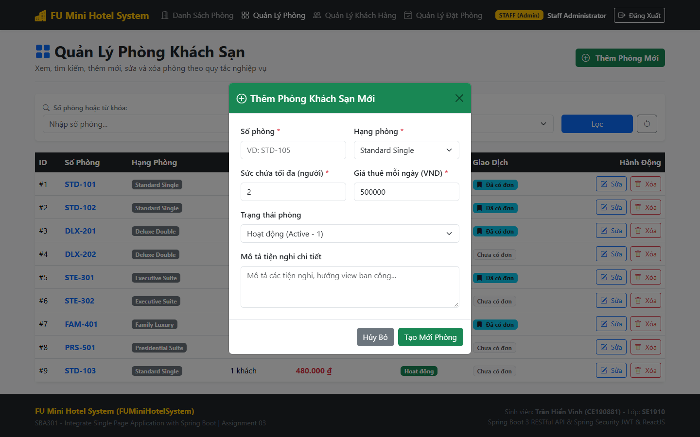
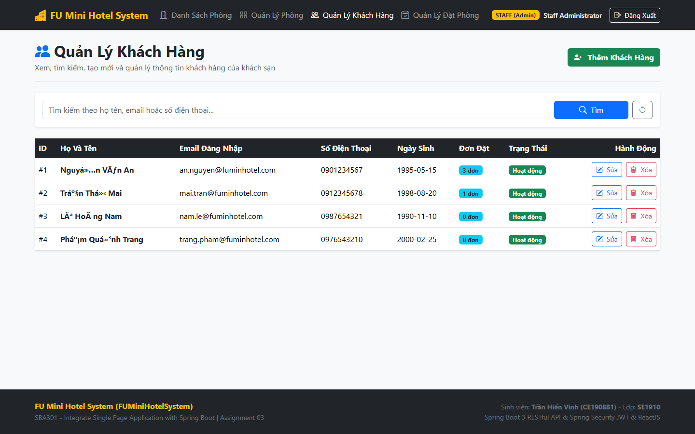
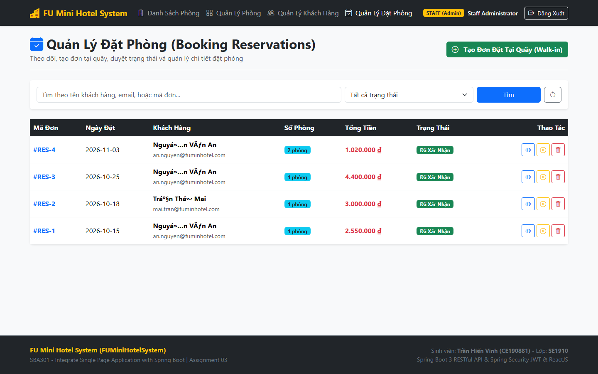

# BÁO CÁO KỸ THUẬT & HƯỚNG DẪN DEMO CHI TIẾT
## ASSIGNMENT 03 - FU MINI HOTEL SYSTEM
**Môn học:** SBA301 - Integrate Single Page Application with Spring Boot  
**Học kỳ:** Fall 2024 / Spring 2025  
**Sinh viên thực hiện:** TRẦN HIỂN VINH  
**MSSV:** CE190881  
**Lớp:** SE1910  
**Cơ sở dữ liệu:** `A3TranHienVinh_SE1910`

---

## PHẦN I: ĐỀ BÀI & YÊU CẦU NGHIỆP VỤ (REQUIREMENTS)

### 1.1. Mục tiêu đồ án
Xây dựng và bảo mật hệ thống quản trị đặt phòng khách sạn (FUMiniHotelSystem) sử dụng Spring Boot 3, Spring Security 6 và JWT (JSON Web Token), kết hợp Single Page Application ReactJS.

### 1.2. Cơ chế Xác thực Độc đáo (Dual Authentication Mechanism)
- **Tài khoản Staff:** ĐƯỢC ĐỌC TRỰC TIẾP TỪ FILE `application.properties` (`hotel.staff.email=staff@fuminhotel.com`, `hotel.staff.password=@1`), hoàn toàn không lưu trữ trong bảng cơ sở dữ liệu.
- **Tài khoản Khách hàng (Customer):** Được lưu trữ và xác thực qua bảng `Customer` trong SQL Server.
- Cả hai đối tượng dùng chung một API đăng nhập `/api/auth/login`, hệ thống tự động phân loại UserDetails và phát hành JWT token tương ứng.

### 1.3. Các Ràng buộc Nghiệp vụ Cốt lõi (Business Rules)
1. **Xóa phòng thông minh (Soft-delete vs Hard-delete):** Khi Staff xóa phòng (`DELETE /api/rooms/{id}`), hệ thống kiểm tra bảng `BookingDetail`. Nếu phòng đã từng được đặt trước đó, hệ thống CHỈ CẬP NHẬT TRẠNG THÁI `RoomStatus = 0` (Inactive/Xóa mềm). Nếu phòng chưa từng được đặt, hệ thống xóa vật lý (Hard-delete).
2. **Đặt nhiều phòng cùng lúc (Multi-room Online Booking):** Khách hàng có thể chọn nhiều phòng khác nhau trong một lượt đặt. Hệ thống tính số ngày lưu trú bằng `ChronoUnit.DAYS.between(startDate, endDate)` và nhân với đơn giá `RoomPricePerDay` của từng phòng để ra `TotalPrice` chính xác.

---

## PHẦN II: KIẾN TRÚC HỆ THỐNG & GIẢI PHÁP BẢO MẬT

### 2.1. Công nghệ sử dụng
- **Backend:** Spring Boot 3.2.5, Java 21, Spring Security 6, JJWT 0.12.6, MS SQL Server JDBC Driver.
- **Frontend:** React 18 SPA (Vite), React Router DOM v6, Axios Bearer Interceptor, React-Bootstrap, Bootstrap Icons.
- **Khóa chính phức hợp (Composite Key):** Bảng `BookingDetail` ánh xạ khóa chính kép gồm `BookingReservationID` và `RoomID` thông qua `@Embeddable BookingDetailId`.

---

## PHẦN III: HÌNH ẢNH DEMO THỰC TẾ HỆ THỐNG (CAPTURED SCREENSHOTS)

Dưới đây là các hình ảnh giao diện thực tế được chụp trực tiếp khi hệ thống đang vận hành:

### 1. Trang chủ Khách sạn & Danh mục Phòng (Public Catalog)

*Hình 1: Danh sách các phòng Active, phân loại phòng, giá thuê theo ngày và sức chứa tối đa.*

### 2. Màn hình Đăng nhập (Hỗ trợ 1-Click Quick Fill)

*Hình 2: Form đăng nhập kèm các nút điền nhanh tài khoản Staff (properties) và Customer (Database).*

### 3. Màn hình Đăng ký Khách hàng mới (Register)

*Hình 3: Form đăng ký thành viên khách hàng mới đầy đủ các trường thông tin.*

### 4. Màn hình Đặt phòng Trực tuyến (Online Booking)

*Hình 4: Chọn ngày Check-in/Check-out, tích chọn nhiều phòng và hệ thống tính tổng tiền tự động.*

### 5. Modal Xác nhận Đơn đặt phòng Thành công

*Hình 5: Popup xác nhận đặt phòng thành công hiển thị mã đặt chỗ.*

### 6. Màn hình Lịch sử Đơn đặt phòng (Customer My Bookings)

*Hình 6: Xem toàn bộ các đơn đặt phòng, chi tiết danh sách phòng đã thuê và thời gian.*

### 7. Màn hình Hồ sơ & Đổi Mật khẩu Khách hàng

*Hình 7: Cập nhật thông tin cá nhân và đổi mật khẩu tài khoản khách hàng.*

### 8. Màn hình Quản trị Phòng dành cho Staff

*Hình 8: Bảng danh sách phòng khách sạn, bộ lọc theo Loại phòng (RoomType), tìm kiếm và thao tác Xóa/Sửa.*

### 9. Modal Thêm mới Phòng khách sạn

*Hình 9: Form thêm mới phòng với số phòng, mô tả, sức chứa và giá tiền.*

### 10. Màn hình Quản lý Danh sách Khách hàng

*Hình 10: Xem danh sách toàn bộ khách hàng và trạng thái kích hoạt tài khoản.*

### 11. Màn hình Báo cáo Doanh thu & Quản lý Đơn đặt phòng

*Hình 11: Lọc đơn đặt phòng theo khoảng ngày và thống kê tổng doanh thu khách sạn.*

---

## PHẦN IV: GIẢI THÍCH MÃ NGUỒN CHI TIẾT

### 4.1. Cơ chế Phân luồng Xác thực Kép (`CustomUserDetailsService.java`)
```java
@Override
public UserDetails loadUserByUsername(String email) throws UsernameNotFoundException {
    // 1. Kiểm tra tài khoản Staff đọc từ file application.properties
    if (staffProperties.getEmail() != null && staffProperties.getEmail().equalsIgnoreCase(email.trim())) {
        String staffPassword = staffProperties.getPassword();
        String encodedStaffPass = staffPassword.startsWith("$2a$") ? staffPassword : passwordEncoder.encode(staffPassword);
        return UserPrincipal.createStaff(staffProperties.getEmail(), encodedStaffPass, staffProperties.getFullName());
    }

    // 2. Kiểm tra tài khoản Khách hàng trong Database
    Customer customer = customerRepository.findByEmailAddress(email.trim())
            .orElseThrow(() -> new UsernameNotFoundException("Không tìm thấy khách hàng: " + email));

    boolean isActive = customer.getCustomerStatus() != null && customer.getCustomerStatus() == 1;
    String customerPassword = customer.getPassword();
    if (customerPassword != null && !customerPassword.startsWith("$2a$") && !customerPassword.startsWith("$2b$")) {
        customerPassword = passwordEncoder.encode(customerPassword);
    }

    return UserPrincipal.createCustomer(
            customer.getCustomerID(), customer.getEmailAddress(), customerPassword,
            customer.getCustomerFullName(), isActive
    );
}
```

### 4.2. Ràng buộc Xóa phòng Thông minh (`RoomServiceImpl.java`)
```java
@Override
@Transactional
public void deleteRoom(Integer roomId) {
    RoomInformation room = roomRepository.findById(roomId)
            .orElseThrow(() -> new ResourceNotFoundException("Room not found with ID: " + roomId));

    // Business Rule: Nếu phòng đã từng được đặt, chỉ soft-delete (RoomStatus = 0)
    boolean hasBooking = bookingDetailRepository.existsByRoom_RoomID(roomId);
    if (hasBooking) {
        room.setRoomStatus((byte) 0); // 0 = Inactive (Xóa mềm)
        roomRepository.save(room);
    } else {
        // Nếu phòng chưa từng được đặt, cho phép xóa cứng vật lý
        roomRepository.delete(room);
    }
}
```
