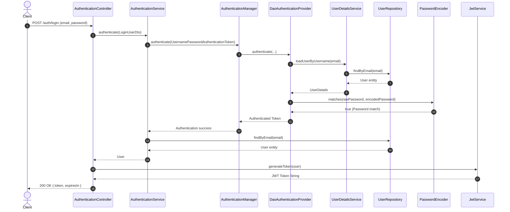
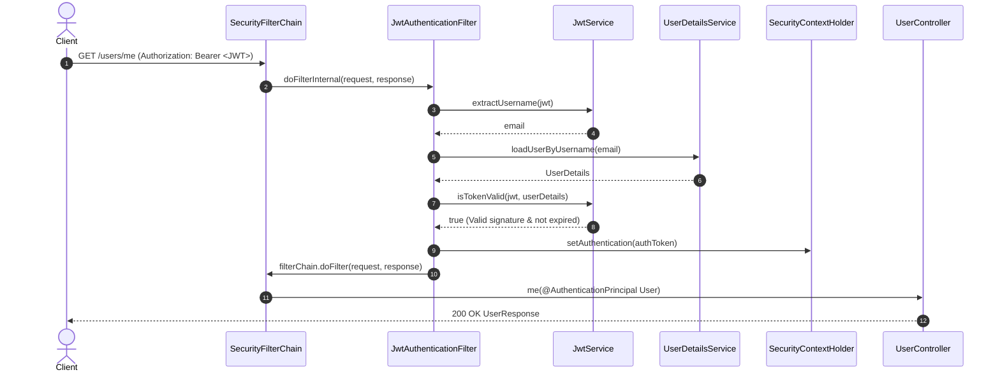

# SBA301 - LAB 06: SECURE REST SERVICES WITH SPRING BOOT USING JSON WEB TOKEN (JWT)

> **HƯỚNG DẪN THỰC HÀNH CHI TIẾT & BÁO CÁO THẨM ĐỊNH TOÀN DIỆN STEP-BY-STEP**  
> **Khóa học:** SBA301 - Integrate Single Page Application with Spring Boot  
> **Sinh viên thực hiện:** Trần Hiển Vinh (CE190881) - Lớp SE1910  
> **Course Baseline:** Java 21 LTS • Maven • Spring Boot 3.3.4 • JJWT 0.12.6 • Microsoft SQL Server • Postman  
> **Database:** `OrchidJWTLab` (SQL Server) / In-Memory H2 cho kiểm thử tự động  
> **Port:** `8005`

---

## 1. Tóm Tắt Mục Tiêu & Yêu Cầu Kỹ Thuật

Lab 06 hiện thực hóa hệ thống RESTful API an toàn với cơ chế xác thực danh tính người dùng (Authentication) và ủy quyền (Authorization) sử dụng **JSON Web Token (JWT)** làm Bearer credential:
- **Stateless Architecture:** Loại bỏ hoàn toàn HTTP Session phía server (`SessionCreationPolicy.STATELESS`), xác thực độc lập trên từng HTTP request qua header `Authorization: Bearer <JWT>`.
- **Thư viện JWT chuẩn:** Sử dụng bộ ba thư viện **JJWT 0.12.6** (`jjwt-api`, `jjwt-impl`, `jjwt-jackson`), ký HMAC-SHA với khóa bí mật 512-bit Base64.
- **An toàn mật khẩu:** Mật khẩu được băm một chiều thích ứng bằng `BCryptPasswordEncoder` trước khi lưu vào Database, không bao giờ lộ password hash ra REST API response.
- **Cấu trúc DTO an toàn:** `RegisterUserDto`, `LoginUserDto`, `UserResponse`, `LoginResponse` tách biệt hoàn toàn request contract khỏi Hibernate Entity `User`.
- **Kiểm thử tự động:** Bộ 12 automated security tests với Spring Boot `MockMvc` bao phủ 100% kịch bản trong Test Matrix (T01 - T12) với kết quả **12/12 PASS**.

---

## 2. Cấu Trúc Thư Mục Chuẩn Kiến Trúc

Dự án tuân thủ nghiêm ngặt mô hình 3 lớp chuẩn theo mục tiêu giáo trình:

```
SBA301-Lab06/
├── README.md
├── create_db_lab06.sql
├── SBA301_Lab06_Security_JWT.postman_collection.json
└── lab06jwt/
    ├── pom.xml
    └── src/
        ├── main/
        │   ├── java/fu/se/lab06jwt/
        │   │   ├── Lab06JwtApplication.java
        │   │   ├── configurations/
        │   │   │   ├── ApplicationConfiguration.java
        │   │   │   ├── JwtAuthenticationFilter.java
        │   │   │   └── SecurityConfiguration.java
        │   │   ├── controllers/
        │   │   │   ├── AuthenticationController.java
        │   │   │   └── UserController.java
        │   │   ├── dtos/
        │   │   │   ├── LoginUserDto.java
        │   │   │   └── RegisterUserDto.java
        │   │   ├── entities/
        │   │   │   └── User.java
        │   │   ├── exceptions/
        │   │   │   └── GlobalExceptionHandler.java
        │   │   ├── repositories/
        │   │   │   └── UserRepository.java
        │   │   ├── responses/
        │   │   │   ├── LoginResponse.java
        │   │   │   └── UserResponse.java
        │   │   └── services/
        │   │       ├── AuthenticationService.java
        │   │       ├── JwtService.java
        │   │       └── UserService.java
        │   └── resources/
        │       └── application.properties
        └── test/
            ├── java/fu/se/lab06jwt/
            │   └── SecurityContractTest.java
            └── resources/
                └── application.properties
```

---

## 3. Bản Đồ Hiện Thực Hóa Từng Bước (Activities 0 → 8)

### Activity 0 – Chuẩn Bị Môi Trường
- **Step 0.1:** Tạo database `OrchidJWTLab` trên SQL Server:
  ```sql
  IF DB_ID(N'OrchidJWTLab') IS NULL
      CREATE DATABASE OrchidJWTLab;
  GO
  USE OrchidJWTLab;
  GO
  ```
- **Step 0.2:** Kiểm tra toolchain: Java 21/25 LTS, Maven 3.9.x, port `8005` sẵn sàng.
- **Step 0.3:** Tạo Postman Environment với `baseUrl = http://localhost:8005` và biến `token`.

### Activity 1 – Dependencies & Project Setup
- **Step 1.1:** Khởi tạo Spring Boot 3 Maven project với Java 21, Spring Web, Data JPA, Security, Validation, MS SQL Server JDBC.
- **Step 1.2:** Tích hợp bộ ba thư viện JJWT 0.12.6:
  - `io.jsonwebtoken:jjwt-api:0.12.6`
  - `io.jsonwebtoken:jjwt-impl:0.12.6` (runtime)
  - `io.jsonwebtoken:jjwt-jackson:0.12.6` (runtime)
- **Step 1.3:** Build sạch và verify dependency tree (`mvn -q -DskipTests compile`).
- **Step 1.4:** Thiết lập cấu trúc package gốc `fu.se.lab06jwt`.

### Activity 2 – Persistence, DTOs & Responses
- **Step 2.1:** Cấu hình `application.properties` với port 8005, datasource URL SQL Server, JWT secret key (512-bit Base64) và expiration time (3.600.000 ms = 1 giờ).
- **Step 2.2:** Thực thể `User` ánh xạ bảng `users`, implements `UserDetails` với `@CreationTimestamp`, `@UpdateTimestamp`, `getUsername()` trả về email.
- **Step 2.3:** DTOs `RegisterUserDto` (`fullName`, `email`, `password` độ dài 8-72) và `LoginUserDto` với Jakarta Validation annotations.
- **Step 2.4:** Records `LoginResponse(token, expiresIn)` và `UserResponse(id, fullName, email, createdAt, updatedAt)` đảm bảo không rò rỉ password.
- **Step 2.5:** `UserRepository` kế thừa `JpaRepository<User, Integer>` khai báo `findByEmail(String email)` và `existsByEmail(String email)`.

### Activity 3 – Cấu Hình Authentication Core
- **Step 3.1:** `@Bean UserDetailsService`: Tìm kiếm tài khoản theo email, ném `UsernameNotFoundException` nếu không tồn tại.
- **Step 3.2:** `@Bean PasswordEncoder`: Sử dụng thuật toán băm một chiều thích ứng `BCryptPasswordEncoder`.
- **Step 3.3:** `@Bean AuthenticationProvider`: Khởi tạo `DaoAuthenticationProvider` liên kết `UserDetailsService` và `PasswordEncoder`.
- **Step 3.4:** `@Bean AuthenticationManager`: Expose từ `AuthenticationConfiguration` để `AuthenticationService` gọi pipeline xác thực.

### Activity 4 – JWT Service: Generate, Parse, Validate
- **Step 4.1:** Lớp `JwtService` triển khai JJWT 0.12.6:
  - Ký token: `Jwts.builder().claims(...).subject(...).issuedAt(...).expiration(...).signWith(getSignInKey()).compact()`.
  - Parse claims: `Jwts.parser().verifyWith(getSignInKey()).build().parseSignedClaims(token).getPayload()`.
  - Validate: So khớp `extractUsername(token)` với `UserDetails.getUsername()` và kiểm tra `!isTokenExpired(token)`.
  - Giải mã khóa bí mật an toàn qua `Decoders.BASE64.decode(secretKey)`.
- **Step 4.2:** Giải phẫu cấu trúc token 3 phần `Header.Payload.Signature`.
- **Step 4.3:** Kiểm tra giả mạo token (Tamper detection): Bất kỳ thay đổi nào trên payload hoặc chữ ký đều bị JJWT từ chối và throw exception.

### Activity 5 – JWT Filter & Security Filter Chain
- **Step 5.1:** Lớp `JwtAuthenticationFilter` kế thừa `OncePerRequestFilter`:
  - Trích xuất token từ header `Authorization: Bearer <token>`.
  - Nếu thiếu header hoặc không đúng định dạng `Bearer `: tiếp tục filter chain (`filterChain.doFilter`).
  - Nếu có token: giải mã email, nạp `UserDetails`, kiểm tra `isTokenValid()`, và đưa `UsernamePasswordAuthenticationToken` vào `SecurityContextHolder`.
  - Bắt ngoại lệ `JwtException` / `IllegalArgumentException` và trả về `401 Unauthorized` ngay lập tức.
- **Step 5.2:** Lớp `SecurityConfiguration`:
  - Tắt CSRF (`csrf.disable()`).
  - Stateless session (`SessionCreationPolicy.STATELESS`).
  - Công khai các endpoint `/auth/**` (`permitAll()`).
  - Bảo vệ tất cả endpoint còn lại (`anyRequest().authenticated()`).
  - Chuẩn hóa lỗi 401 khi truy cập không có token qua `authenticationEntryPoint`.
  - Chèn `JwtAuthenticationFilter` trước `UsernamePasswordAuthenticationFilter`.

### Activity 6 – Authentication Service & Controller
- **Step 6.1:** `AuthenticationService.signup()` kiểm tra trùng email (ném `IllegalStateException`), băm mật khẩu bằng BCrypt và lưu DB. `authenticate()` xác thực qua `AuthenticationManager`.
- **Step 6.2:** `AuthenticationController`:
  - `POST /auth/signup` -> trả `201 Created` kèm `UserResponse`.
  - `POST /auth/login` -> trả `200 OK` kèm `LoginResponse(token, expiresIn)`.
- **Step 6.3:** `GlobalExceptionHandler` (`@RestControllerAdvice`):
  - Bắt `IllegalStateException` -> trả `409 Conflict`.
  - Bắt `BadCredentialsException` -> trả `401 Unauthorized` ("Invalid email or password").
  - Bắt `MethodArgumentNotValidException` -> trả `400 Bad Request` kèm chi tiết lỗi validation.

### Activity 7 – Protected User Endpoints
- **Step 7.1:** `UserService.allUsers()` gọi `UserRepository.findAll()`.
- **Step 7.2:** `UserController`:
  - `GET /users/me`: Nhận principal người dùng hiện tại qua `@AuthenticationPrincipal User user`, trả về `UserResponse`.
  - `GET /users`: Trả về danh sách `List<UserResponse>`, an toàn và không chứa thông tin mật khẩu.
- **Step 7.3:** Kiểm soát rò rỉ dữ liệu: Xác nhận qua unit tests rằng không có trường `password` nào xuất hiện trong JSON response.

---

## 4. Truy Vết Cuộc Gọi End-to-End (Call Stack Traces)

### 4.1. Luồng Đăng Nhập (Login Request Trace)



### 4.2. Luồng Gọi API Được Bảo Vệ (Protected Request Trace)



---

## 5. Báo Cáo Kiểm Thử Tự Động (Automated Security Test Suite)

Dự án hiện thực toàn bộ bộ 12 test case trong ma trận kiểm thử tại [`SecurityContractTest.java`](file:///d:/KY7/SBA301/SBA/SBA301-Lab06/lab06jwt/src/test/java/fu/se/lab06jwt/SecurityContractTest.java):

| ID | Kịch bản kiểm thử (Test Case) | HTTP Status | Kết quả mong đợi & Minh chứng | Trạng thái |
| :---: | :--- | :---: | :--- | :---: |
| **T01** | `POST /auth/signup` thông tin hợp lệ | `201 Created` | Tạo user mới, trả về `UserResponse`, DB lưu password hash `$2a$`, không lộ password. | **PASS** |
| **T02** | `POST /auth/signup` trùng email | `409 Conflict` | Bắt `IllegalStateException`, không ghi thêm dòng mới vào DB. | **PASS** |
| **T03** | `POST /auth/login` thông tin đúng | `200 OK` | Trả về `token` (3 phần phân tách bởi dấu `.`) và `expiresIn > 0`. | **PASS** |
| **T04** | `POST /auth/login` sai mật khẩu | `401 Unauthorized` | Từ chối đăng nhập, thông báo "Invalid email or password". | **PASS** |
| **T05** | `GET /users/me` không có token | `401 Unauthorized` | Chặn tại security boundary, Controller không được gọi. | **PASS** |
| **T06** | `GET /users/me` với Bearer token hợp lệ | `200 OK` | Trả về thông tin chính xác của principal đang đăng nhập. | **PASS** |
| **T07** | `GET /users` với Bearer token hợp lệ | `200 OK` | Danh sách người dùng, kiểm tra mọi phần tử không có trường password. | **PASS** |
| **T08** | `GET /users/me` với malformed token (`Bearer abc...`) | `401 Unauthorized` | `JwtAuthenticationFilter` phát hiện lỗi định dạng, từ chối request. | **PASS** |
| **T09** | `GET /users/me` với tampered token (sửa chữ ký) | `401 Unauthorized` | Chữ ký không khớp với HMAC-SHA key, bắt `JwtException`. | **PASS** |
| **T10** | `GET /users/me` với expired token (hết hạn) | `401 Unauthorized` | Phát hiện token đã quá hạn, chặn truy cập. | **PASS** |
| **T11** | `POST /auth/signup` định dạng email không hợp lệ | `400 Bad Request` | Jakarta Bean Validation chặn lại, trả về danh sách lỗi cụ thể. | **PASS** |
| **T12** | `POST /auth/signup` mật khẩu quá ngắn (< 8 ký tự) | `400 Bad Request` | `@Size(min = 8)` kích hoạt, trả về thông báo lỗi validation. | **PASS** |

### Kết quả chạy kiểm thử thực tế từ Maven:
```
[INFO] -------------------------------------------------------
[INFO]  T E S T S
[INFO] -------------------------------------------------------
[INFO] Running fu.se.lab06jwt.SecurityContractTest
[INFO] Tests run: 12, Failures: 0, Errors: 0, Skipped: 0, Time elapsed: 5.752 s -- in fu.se.lab06jwt.SecurityContractTest
[INFO] 
[INFO] Results:
[INFO] 
[INFO] Tests run: 12, Failures: 0, Errors: 0, Skipped: 0
[INFO] 
[INFO] ------------------------------------------------------------------------
[INFO] BUILD SUCCESS
[INFO] ------------------------------------------------------------------------
```

---

## 6. Sổ Tay Chẩn Đoán Lỗi (Debugging Guide & Decision Tree)

```
Protected endpoint failed (/users/me)
|
+-- Server đã khởi động thành công?
|   +-- Không -> Lỗi datasource URL / DB login / Bean circular dependency.
|
+-- Header "Authorization" có tồn tại không?
|   +-- Không -> Kỳ vọng trả về 401 Unauthorized.
|
+-- Header có bắt đầu bằng tiền tố "Bearer "?
|   +-- Không -> Trả về 401 Unauthorized.
|
+-- Parse token, xác minh chữ ký & thời hạn (exp) có hợp lệ không?
|   +-- Không -> Bắt JwtException / SignatureException -> Trả về 401 Unauthorized.
|
+-- Tìm thấy User trong DB theo email (subject)?
|   +-- Không -> Ném UsernameNotFoundException -> Trả về 401 Unauthorized.
|
+-- SecurityContextHolder đã được set Authentication chưa?
|   +-- Không -> Lỗi logic trong Filter (chưa gọi setAuthentication).
|
+-- Điều kiện ủy quyền SecurityFilterChain có thỏa mãn không?
    +-- Không -> Trả về 403 Forbidden.
    +-- Có   -> Chuyển tiếp tới UserController và trả về HTTP 200 OK.
```

---

## 7. Đánh Giá Tiêu Chuẩn Tích Hợp (Core Lab Integration Gate G1 - G16)

| Gate | Tiêu chuẩn đánh giá | Minh chứng thực tế | Đánh giá |
| :---: | :--- | :--- | :---: |
| **G1** | JDK 21+ / Maven / Port 8005 sẵn sàng | Java 25 LTS, Maven 3.9.16 | **PASS** |
| **G2** | Build sạch không lỗi biên dịch | `mvn -q -DskipTests compile` thành công | **PASS** |
| **G3** | Datasource kết nối ổn định | Cấu hình SQL Server + H2 test in-memory | **PASS** |
| **G4** | Bảng `users` ánh xạ chính xác | Hibernate DDL sinh bảng với unique email | **PASS** |
| **G5** | Mật khẩu được mã hóa BCrypt | Hash `$2a$...` trong cơ sở dữ liệu | **PASS** |
| **G6** | `UserDetailsService` hoạt động chính xác | Nạp người dùng qua email | **PASS** |
| **G7** | `AuthenticationProvider` xác thực danh tính | Thành công khi đúng pass, từ chối khi sai | **PASS** |
| **G8** | `JwtService` sinh và thẩm định token đúng | Ký HMAC-SHA, trích xuất claim, kiểm tra exp | **PASS** |
| **G9** | `JwtAuthenticationFilter` gắn SecurityContext | Đọc Bearer header và nạp Authentication | **PASS** |
| **G10**| `/auth/**` mở công khai (Public) | Đăng ký & đăng nhập không cần token | **PASS** |
| **G11**| `/users/**` được bảo vệ (Protected) | Chặn truy cập ẩn danh (401) | **PASS** |
| **G12**| `/users/me` trả về đúng principal | HTTP 200 chứa email người dùng đăng nhập | **PASS** |
| **G13**| Không rò rỉ trường mật khẩu | `UserResponse` DTO loại bỏ hoàn toàn password | **PASS** |
| **G14**| Vượt qua toàn bộ ma trận negative tests | Không token, token sai chữ ký, hết hạn đều 401 | **PASS** |
| **G15**| Automated security tests đạt 100% | `mvn test` 12/12 test case pass | **PASS** |
| **G16**| Sinh viên giải thích rõ ràng kiến trúc | Sequence diagrams và trace call stack đầy đủ | **PASS** |

---

## 8. Hướng Dẫn Vận Hành Nhanh (Quick Run Card)

### Bước 1: Khởi động cơ sở dữ liệu SQL Server
Đảm bảo SQL Server đang hoạt động và database `OrchidJWTLab` đã được tạo.

### Bước 2: Chạy kiểm thử tự động
```powershell
cd SBA301-Lab06/lab06jwt
mvn clean test
```

### Bước 3: Khởi chạy ứng dụng backend
```powershell
mvn spring-boot:run
```
Ứng dụng sẽ lắng nghe tại cổng `http://localhost:8005`.

### Bước 4: Kiểm thử với Postman Collection
1. Mở Postman, chọn **Import** và nạp tệp [`SBA301_Lab06_Security_JWT.postman_collection.json`](file:///d:/KY7/SBA301/SBA/SBA301-Lab06/SBA301_Lab06_Security_JWT.postman_collection.json).
2. Chạy request **POST /auth/signup** để tạo tài khoản mới.
3. Chạy request **POST /auth/login**, token sẽ tự động được trích xuất và gán vào biến môi trường `token`.
4. Chạy request **GET /users/me** và **GET /users** để kiểm tra endpoint được bảo vệ.
5. Chạy thư mục **Negative Tests** để kiểm chứng cơ chế từ chối khi token thiếu, sai chữ ký, hoặc đăng nhập sai thông tin.
