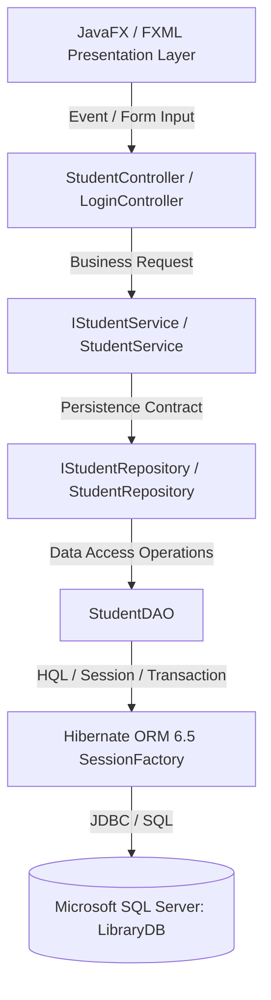

# BÁO CÁO THỰC HÀNH LAB 07 - SBA301
## XÂY DỰNG ỨNG DỤNG DESKTOP VỚI JAVAFX VÀ HIBERNATE ORM (REPOSITORY PATTERN)

- **Môn học:** SBA301 - Framework-Based Application Development
- **Sinh viên:** Trần Hiển Vinh
- **Mã sinh viên:** CE190881
- **Lớp:** SE1910
- **Database:** Microsoft SQL Server (`LibraryDB`)
- **Nền tảng:** JDK 21 • Maven 3.9+ • JavaFX 21 • Hibernate ORM 6.5 • Gluon Scene Builder

---

## 1. TỔNG QUAN & KIẾN TRÚC HỆ THỐNG

Ứng dụng phục vụ Phòng Thư viện (Library Department) quản lý thông tin Sinh viên (`STUDENTS`), Sách (`BOOKS`), và quan hệ Mượn Sách nhiều-nhiều (`STUDENTS_BOOKS`). Ứng dụng tuân thủ nghiêm ngặt mô hình kiến trúc nhiều lớp (**Layered Architecture**) kết hợp **Repository Pattern**:

### 1.1. Sơ đồ luồng xử lý và phân tầng



### 1.2. Nguyên tắc kiến trúc đã đảm bảo
- **Tách biệt mối quan tâm (SoC):** Presentation Layer (JavaFX/Controller) không bao giờ trực tiếp tạo hoặc gọi Hibernate `Session`/`Transaction`. Controller chỉ phụ thuộc vào `IStudentService`.
- **Repository Pattern:** `IStudentRepository` đóng gói toàn bộ hợp đồng lưu trữ dữ liệu, che giấu chi tiết cài đặt của `StudentDAO` và Hibernate ORM.
- **Service Layer Boundary:** `StudentService` đảm nhiệm kiểm tra tính hợp lệ dữ liệu (validation điểm `0.0 <= marks <= 10.0`, kiểm tra email trùng lặp, xác thực đăng nhập) trước khi chuyển tiếp cho Repository.
- **Composition Root:** Tại `StudentApplication.init()`, ứng dụng khởi tạo chuỗi phụ thuộc (`SessionFactory` -> `DAO` -> `Repository` -> `Service`) và inject vào Controller.

---

## 2. CẤU TRÚC THƯ MỤC DỰ ÁN

```text
SBA301-Lab07/
├── pom.xml                                   # Cấu hình Maven, Java 21, JavaFX, Hibernate, MSSQL Driver
├── create_db_lab07.sql                       # Script tạo Database LibraryDB, Tables và Seed Data
├── README.md                                 # Báo cáo chi tiết và hướng dẫn sử dụng
└── src/
    ├── main/
    │   ├── java/
    │   │   ├── module-info.java              # JPMS Module descriptor (JavaFX + Hibernate reflection)
    │   │   └── fu/se/lab07/
    │   │       ├── Launcher.java             # Entry point tương thích mọi runtime environment
    │   │       ├── app/
    │   │       │   └── ConsoleSmokeTest.java # Smoke test backend chạy độc lập không cần UI
    │   │       ├── entity/
    │   │       │   ├── Book.java             # Entity ánh xạ bảng BOOKS
    │   │       │   └── Student.java          # Entity ánh xạ bảng STUDENTS (Many-to-Many với Book)
    │   │       ├── dao/
    │   │       │   └── StudentDAO.java       # Triển khai CRUD qua Hibernate Session và Transaction
    │   │       ├── repository/
    │   │       │   ├── IStudentRepository.java
    │   │       │   └── StudentRepository.java
    │   │       ├── service/
    │   │       │   ├── IStudentService.java
    │   │       │   └── StudentService.java   # Business logic, validation, authentication
    │   │       └── ui/
    │   │           ├── StudentApplication.java # JavaFX Application (Composition Root)
    │   │           └── controller/
    │   │               ├── LoginController.java
    │   │               └── StudentController.java
    │   └── resources/
    │       ├── hibernate.cfg.xml             # Cấu hình Hibernate SessionFactory & connection pool
    │       └── fu/se/lab07/ui/
    │           ├── LoginGUI.fxml             # Màn hình đăng nhập
    │           ├── student-view.fxml         # Màn hình quản lý sinh viên (Form + TableView)
    │           └── styles.css                # CSS giao diện hiện đại (Modern Light Theme)
    └── test/
        └── java/
            └── fu/se/lab07/
                ├── ConsoleSmokeTestTest.java # Test runner cho ConsoleSmokeTest
                └── StudentServiceTest.java   # 11 Unit/Integration Tests kiểm thử tự động toàn diện
```

---

## 3. THIẾT KẾ CƠ SỞ DỮ LIỆU & SEED DATA

Cơ sở dữ liệu: **`LibraryDB`** trong SQL Server.
Tập lệnh [create_db_lab07.sql](create_db_lab07.sql) chứa đầy đủ cấu trúc 3 bảng và dữ liệu mẫu:

1. **`BOOKS`**:
   - `id` (INT, IDENTITY, PK)
   - `author` (NVARCHAR(255), NOT NULL)
   - `isbn` (NVARCHAR(255), UNIQUE, NOT NULL)
   - `title` (NVARCHAR(255), NOT NULL)
2. **`STUDENTS`**:
   - `id` (INT, IDENTITY, PK)
   - `email` (NVARCHAR(255), UNIQUE, NOT NULL)
   - `password` (NVARCHAR(255), NOT NULL)
   - `firstName` (NVARCHAR(255), NOT NULL)
   - `lastName` (NVARCHAR(255), NOT NULL)
   - `marks` (FLOAT, NOT NULL)
3. **`STUDENTS_BOOKS`** (Join Table Many-to-Many):
   - `student_id` (INT, FK -> STUDENTS.id)
   - `book_id` (INT, FK -> BOOKS.id)

### Tài khoản đăng nhập mẫu sẵn có:
| Email | Password | Họ và tên | Điểm | Quyền |
| :--- | :--- | :--- | :--- | :--- |
| `admin@fpt.edu.vn` | `123456` | Admin System | 10.0 | Quản trị viên |
| `vinhth@fpt.edu.vn` | `123456` | Trần Hiển Vinh | 9.5 | Sinh viên |
| `lab07@fpt.edu.vn` | `123456` | Lab Seven | 8.0 | Sinh viên |
| `alice@fpt.edu.vn` | `123456` | Alice Nguyen | 7.5 | Sinh viên |
| `bob@fpt.edu.vn` | `123456` | Bob Le | 6.0 | Sinh viên |

---

## 4. CHI TIẾT CÁC ACTIVITY ĐÃ THỰC HIỆN

### Activity 0: Chuẩn bị Toolchain và Cơ sở dữ liệu
- Khởi tạo Database `LibraryDB` trên Microsoft SQL Server Developer Edition.
- Kiểm tra JDK 21 và Apache Maven 3.9 hoạt động chính xác.

### Activity 1: Phân tích và Thiết kế Giao diện FXML (Scene Builder)
- Thiết kế `student-view.fxml`:
  - Form nhập liệu gồm các trường: Email (`txtEmail`), Password (`txtPassword`), First Name (`txtFirstName`), Last Name (`txtLastName`), Marks (`txtMarks`).
  - Hàng nút hành động: **Add Student** (`#handleCreate`), **Update Student** (`#handleUpdate`), **Delete Student** (`#handleDelete`), **Clear Form** (`#handleClear`).
  - `TableView` (`tblStudents`) hiển thị 5 cột: `colId`, `colEmail`, `colFirstName`, `colLastName`, `colMarks`.
- Thiết kế `LoginGUI.fxml`:
  - Card đăng nhập trung tâm với các trường Email, Password, nút Login (`#handleLogin`) và Cancel (`#handleCancel`).
- Áp dụng file phong cách thẩm mỹ `styles.css` với bảng màu xanh hải quân sang trọng, đổ bóng mềm mại và hiệu ứng hover phản hồi nhanh.

### Activity 2: Cài đặt Hibernate ORM, DAO, Repository và Service
- Cấu hình [hibernate.cfg.xml](src/main/resources/hibernate.cfg.xml) trỏ đến `jdbc:sqlserver://localhost:1433;databaseName=LibraryDB`.
- Xây dựng Entities:
  - `Book.java`: Ánh xạ bảng `BOOKS`, khai báo `@ManyToMany(mappedBy = "books")`.
  - `Student.java`: Ánh xạ bảng `STUDENTS`, khai báo `@ManyToMany` với `@JoinTable(name = "STUDENTS_BOOKS")` làm owning side, kèm các helper method `addBook()` và `removeBook()`.
- Cài đặt `StudentDAO.java`:
  - Đóng gói Session lifecycle: `save()`, `findAll()`, `findById()`, `findByEmail()`, `update()`, `delete()`.
  - Mọi thao tác ghi dữ liệu đều được bao bọc trong `beginTransaction()`, `commit()`, và `rollback()` an toàn khi xảy ra ngoại lệ.
- Cài đặt `IStudentRepository.java` & `StudentRepository.java`.
- Cài đặt `IStudentService.java` & `StudentService.java`:
  - Kiểm tra tính hợp lệ dữ liệu đầu vào.
  - Kiểm tra logic kinh doanh: cấm trùng email khi tạo mới hoặc cập nhật.
  - Hàm `login(email, password)` đối chiếu thông tin đăng nhập từ cơ sở dữ liệu.
- Viết `ConsoleSmokeTest.java`: Kiểm thử thành công độc lập toàn bộ các bước CRUD mà không phụ thuộc vào UI.

### Activity 3: Phát triển Trang Quản lý Sinh viên JavaFX
- Xây dựng `StudentController.java`:
  - `initialize()`: Gắn kết `PropertyValueFactory` cho các cột, gán listener chọn dòng trên TableView tự động đổ dữ liệu lên Form (`populateForm`).
  - `handleCreate()`: Đọc và xác thực dữ liệu từ Form, gọi `studentService.create()`, làm mới TableView và thông báo thành công.
  - `handleUpdate()`: Giữ chính xác `selectedStudentId`, cập nhật thông tin qua `studentService.update()`.
  - `handleDelete()`: Hiển thị hộp thoại xác nhận `Confirmation Dialog`, xóa thông qua `studentService.delete()`.
  - `handleClear()`: Xóa dữ liệu trên Form và giải phóng dòng chọn trên bảng.
  - Validate Marks: Bắt ngoại lệ `NumberFormatException` và kiểm tra giá trị nằm trong đoạn `[0.0, 10.0]`.

### Activity 4: Thiết kế và Tích hợp Trang Đăng nhập (Login Flow)
- Xây dựng `LoginController.java`:
  - Tiếp nhận thông tin email/password, chuyển giao cho `studentService.login()`.
  - Nếu thông tin sai: Hiển thị Error Alert chi tiết ("Invalid email or password").
  - Nếu đăng nhập thành công: Điều hướng Stage sang màn hình `student-view.fxml`, truyền `studentService` và hiển thị email của tài khoản đang đăng nhập trên thanh tiêu đề.

---

## 5. KẾT QUẢ KIỂM THỬ (TEST MATRIX & CHECKLIST G1–G16)

### 5.1. Bảng kết quả Test Matrix (T01 - T16)

| Mã Test | Nội dung kiểm thử | Kết quả mong đợi | Trạng thái thực tế |
| :--- | :--- | :--- | :---: |
| **T01** | SessionFactory bootstrap | Khởi tạo thành công, không exception | **PASS** |
| **T02** | Create Student | INSERT thành công, sinh ID tự tăng | **PASS** |
| **T03** | Find all Students | SELECT danh sách chính xác từ SQL Server | **PASS** |
| **T04** | Find Student by ID | Trả về đúng bản ghi tương ứng ID | **PASS** |
| **T05** | Find missing ID | Trả về exception `Student not found` | **PASS** |
| **T06** | Validation Marks | Chặn giá trị `< 0` hoặc `> 10` tại Service | **PASS** |
| **T07** | Duplicate Email | Chặn email đã tồn tại trong database | **PASS** |
| **T08** | Update Student | Cập nhật đúng các trường thông tin trong DB | **PASS** |
| **T09** | Login Valid | Đăng nhập thành công với tài khoản hợp lệ | **PASS** |
| **T10** | Login Invalid | Chặn khi sai mật khẩu hoặc không tồn tại email | **PASS** |
| **T11** | Delete Student | Xóa sạch sinh viên và liên kết sách trong DB | **PASS** |
| **T12** | FXML Loading | `FXMLLoader` nạp FXML và Controller trơn tru | **PASS** |
| **T13** | TableView Binding | Dữ liệu DB hiển thị đầy đủ trên TableView | **PASS** |
| **T14** | Row Selection Sync | Click dòng -> Điền form + gán đúng StudentID | **PASS** |
| **T15** | UI CRUD End-to-End | Thêm, sửa, xóa trên UI phản ánh ngay vào DB | **PASS** |
| **T16** | Architecture Audit | Controller hoàn toàn không import Hibernate/Session | **PASS** |

### 5.2. Kết quả chạy JUnit Test tự động

```text
[INFO] Running fu.se.lab07.StudentServiceTest
[INFO] Tests run: 11, Failures: 0, Errors: 0, Skipped: 0, Time elapsed: 2.871 s
[INFO] Running fu.se.lab07.ConsoleSmokeTestTest
[INFO] Tests run: 1, Failures: 0, Errors: 0, Skipped: 0, Time elapsed: 12.62 s
[INFO] ------------------------------------------------------------------------
[INFO] BUILD SUCCESS
[INFO] ------------------------------------------------------------------------
```

### 5.3. Bảng tự đánh giá tiêu chuẩn Integration Gates (G1 - G16)

- [x] **G1 - Toolchain:** JDK 21, Maven 3.9, SQL Server, Scene Builder sẵn sàng.
- [x] **G2 - Database:** Database `LibraryDB` hoạt động ổn định trên port 1433.
- [x] **G3 - Hibernate Config:** SessionFactory khởi tạo hợp lệ qua `hibernate.cfg.xml`.
- [x] **G4 - Entity Mapping:** Hoàn thành đầy đủ 3 bảng `STUDENTS`, `BOOKS`, `STUDENTS_BOOKS`.
- [x] **G5 - DAO Layer:** `StudentDAO` xử lý đầy đủ CRUD kèm quản lý transaction an toàn.
- [x] **G6 - Repository Contract:** `IStudentRepository` và `StudentRepository` trừu tượng hóa DAO.
- [x] **G7 - Service Layer:** `StudentService` quản lý quy tắc nghiệp vụ, validation và xác thực.
- [x] **G8 - Core Smoke Test:** `ConsoleSmokeTest` chạy thành công độc lập 100%.
- [x] **G9 - JavaFX FXML:** `student-view.fxml` và `LoginGUI.fxml` biên dịch hợp lệ.
- [x] **G10 - TableView Binding:** Hiển thị danh sách sinh viên đồng bộ với dữ liệu SQL Server.
- [x] **G11 - Row Selection:** Bắt sự kiện click chọn dòng, gán chính xác `selectedStudentId`.
- [x] **G12 - UI CRUD:** Các thao tác Create / Update / Delete từ UI cập nhật database ngay lập tức.
- [x] **G13 - Input Validation:** Chặn lỗi nhập sai format điểm số, thông báo lỗi thân thiện.
- [x] **G14 - Login Authentication:** Xác thực tài khoản đăng nhập và chuyển màn hình thành công.
- [x] **G15 - Architecture Compliance:** Presentation layer không vi phạm tầng Hibernate ORM.
- [x] **G16 - Evidence Package:** Đầy đủ mã nguồn, script cơ sở dữ liệu và báo cáo tài liệu.

---

## 6. HƯỚNG DẪN KHỞI CHẠY DỰ ÁN

### 6.1. Khởi tạo Cơ sở dữ liệu (Nếu cần thiết lập lại)
Mở SQL Server Management Studio (SSMS) hoặc dòng lệnh:
```bash
sqlcmd -S localhost -U sa -P 123456 -i "create_db_lab07.sql"
```

### 6.2. Chạy Kiểm thử tự động (Unit & Integration Tests)
```bash
mvn test
```

### 6.3. Chạy Smoke Test giao diện Console
```bash
mvn test -Dtest=ConsoleSmokeTestTest
```

### 6.4. Chạy Ứng dụng Desktop JavaFX
Sử dụng JavaFX Maven Plugin:
```bash
mvn javafx:run
```
Hoặc mở thư mục `SBA301-Lab07` trong **IntelliJ IDEA**, nhấn chuột phải vào file `fu.se.lab07.Launcher` hoặc `fu.se.lab07.ui.StudentApplication` và chọn **Run**.

Đăng nhập bằng tài khoản:
- **Email:** `admin@fpt.edu.vn`
- **Password:** `123456`
